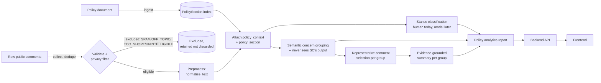
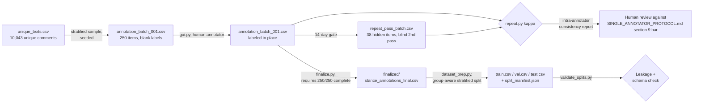
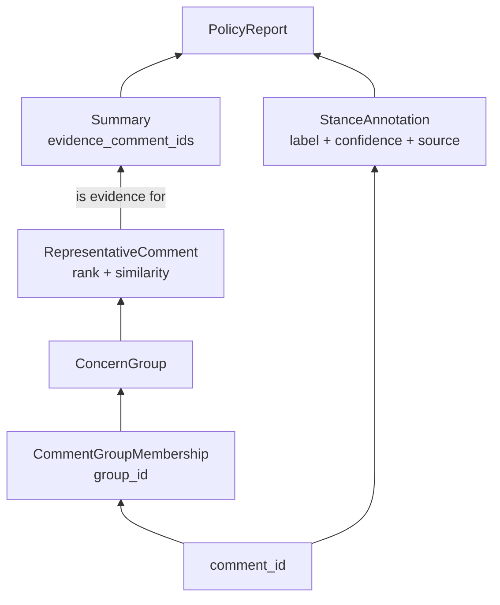

# PolicyLens — Data Flow Diagrams

Companion to [`SYSTEM_ARCHITECTURE.md`](SYSTEM_ARCHITECTURE.md): the same
14-component design, shown as flow rather than a component map. **Design
document — no code in this repository implements the full end-to-end
flow shown here yet**; the implemented subset is the annotation subsystem
(`scripts/annotation/`), ML dataset prep (`ml/stance_classification/`),
and — as of the backend implementation phase — components 1-3 and 12-13
(policy/document ingestion, comment collection, validation/privacy
flagging, the database, and the API) under `backend/app/`, documented in
full in [`../backend/`](../backend/). Components 6-11 (stance
classification, concern grouping, representative selection,
summarization, analytics, traceability) exist in the backend only as
database schema and abstract ML interfaces
(`backend/app/ml_interfaces/`) — no concrete prediction/clustering/
summarization logic runs yet, per
[`../backend/ML_INTEGRATION_GUIDE.md`](../backend/ML_INTEGRATION_GUIDE.md).
The diagrams below still map the full proposed flow; where real code
exists today, the diagram text says so explicitly.

## 1. End-to-end pipeline flow

**Reading this diagram:** the stance-classification branch (`CTX -> SC`)
and the concern-grouping branch (`CTX -> CG -> RS -> SUM`) both start from
the same preprocessed, context-attached comment, but never feed into each
other — this is the independence principle from
`SYSTEM_ARCHITECTURE.md` made visible as two separate paths that only
rejoin at the very end, inside the read-only policy analytics report.

## 2. Today's implemented flow (annotation + dataset prep)

This is the diagram that corresponds to code that actually exists and
runs today. Every other diagram in this document is the proposed future
extension of this same pattern.

## 3. Single-comment traceability path

The architecture's "result traceability" component (11) isn't a separate
pipeline stage — it's a guarantee that this reverse path always resolves:

Any `PolicyReport` number or `Summary` sentence must be walkable back,
right to left, to the exact `comment_id`(s) behind it — see
[`DATA_MODEL.md`](DATA_MODEL.md)'s traceability section for the schema-
level guarantees that make this possible, and
`SYSTEM_ARCHITECTURE.md` component 11 for the integrity check that
verifies it structurally.

## Notes on diagram scope

- These diagrams describe comments that pass eligibility (component 3).
  Excluded comments are retained in storage (per the project's existing
  "exclusion affects labeling, not retention" principle) but do not flow
  through classification or clustering — shown explicitly as a dead-end
  box in diagram 1, not omitted.
- No diagram here implies synchronous, real-time processing — components
  6 ("stance classification") and 7 ("semantic concern grouping") are
  batch processes in every current and planned implementation; the
  backend API (component 12, not yet implemented) would expose their
  *results*, not trigger them inline per request.
