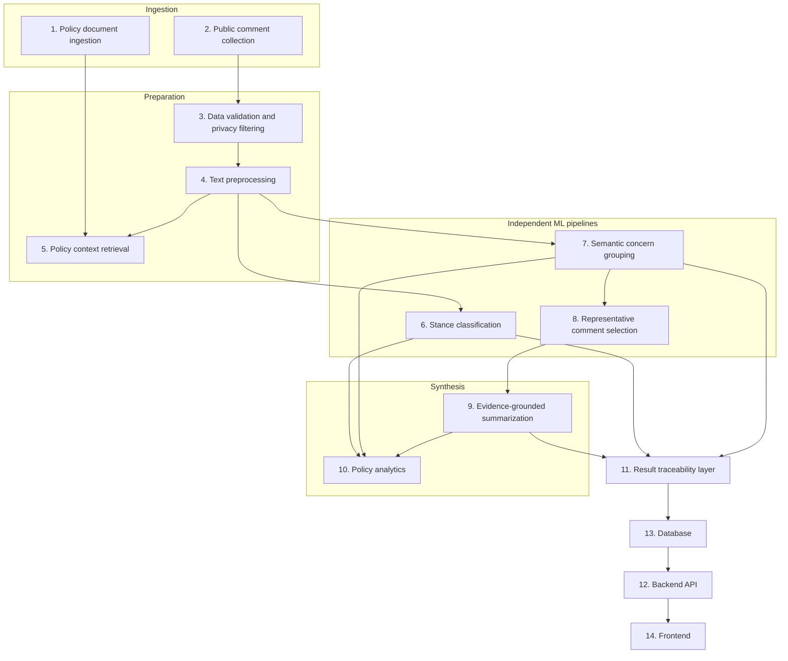

# PolicyLens — System Architecture

**Status:** design document. Describes the intended modular architecture
for the full system. As of this writing, the implemented portions are the
**annotation subsystem** (`scripts/annotation/`) and the **ML dataset
preparation architecture** (`ml/stance_classification/dataset_prep.py` +
`validate_splits.py`) — see [`PROJECT_STATUS.md`](../../PROJECT_STATUS.md)
for exactly what exists versus what this document proposes. The
**backend API, database, and frontend** described here (components 12–14)
are **not yet implemented**; they are included for architectural
completeness and to guide future implementation, not as a claim of
present functionality.

## Design principle this architecture is built around

**Stance classification and semantic concern grouping are independent
pipelines that share inputs but never each other's outputs as features.**
A comment's concern-group membership must never be derived from its
stance, and a comment's stance must never be inferred from its concern
group. Every component below respects this split — see
[`../experiments/SEMANTIC_GROUPING_EXPERIMENT_PLAN.md`](../experiments/SEMANTIC_GROUPING_EXPERIMENT_PLAN.md)
for the full rationale. The second organizing principle is
**traceability**: every aggregate output (a stance prediction, a concern
cluster, a summary) must be traceable back to the exact original
comment(s) and policy section(s) it came from — see
[`DATA_MODEL.md`](DATA_MODEL.md).

## Component overview

---

## 1. Policy document ingestion

- **Responsibilities:** accept a policy document (and, where the source
  provides it, a section/clause structure), store it immutably, and make
  its sections addressable for component 5 (policy context retrieval).
- **Inputs:** a policy document file (PDF/HTML/plain text) plus source
  metadata (title, jurisdiction, publication date, source URL).
- **Outputs:** a `PolicyDocument` record and, where a section structure
  exists or can be derived, `PolicySection` records (see
  [`DATA_MODEL.md`](DATA_MODEL.md)).
- **Dependencies:** none upstream; everything else that references policy
  context depends on this.
- **Data schema:** `PolicyDocument(policy_id, title, jurisdiction,
  source_url, ingested_at, raw_text_ref, section_index)`.
- **Error handling:** a document that cannot be parsed into any section
  structure is still ingested as a single whole-document section (see
  `SINGLE_ANNOTATOR_PROTOCOL.md` section 5's own real-world case: the
  current corpus has no formal policy document, only survey-question-level
  context — this component must degrade gracefully to that same pattern,
  not require a structure that isn't always available).
- **Evaluation requirements:** none ML-specific; correctness is verified
  by round-trip checks (ingested section text matches source) rather than
  a model metric.

## 2. Public comment collection

- **Responsibilities:** accept raw public comments from one or more
  sources (the current project's three historical datasets, or a future
  live submission channel) and assign each a **stable, permanent
  `comment_id`** at the moment of collection — never reassigned, never
  reused.
- **Inputs:** raw comment records from a source system (file upload, form
  submission, API).
- **Outputs:** `RawComment` records, deduplicated at the text level (see
  the canonical corpus's own `unique_texts.csv` precedent: 10,043 unique
  texts deduplicated from 10,108 raw entries, with a `multiplicity` count
  preserved rather than discarded).
- **Dependencies:** none upstream.
- **Data schema:** `RawComment(comment_id, original_text, source_dataset,
  source_record_id, collected_at, language, multiplicity)` — this exactly
  mirrors the corpus schema already in
  `data/processed/canonical_corpus/unique_texts.csv`, kept consistent
  rather than reinvented.
- **Error handling:** malformed/empty records are retained with a
  recorded parse-error flag, not silently dropped — the project's existing
  principle (`STANCE_ANNOTATION_GUIDELINES.md` section 5: "excluded
  comments are still retained... exclusion affects stance labeling only,
  not data retention") extends naturally to ingestion-time errors too.
- **Evaluation requirements:** none ML-specific; deduplication correctness
  is checked structurally (no two `comment_id`s with identical normalized
  text slip through — the same check `ml/stance_classification/
  dataset_prep.py`'s `verify_no_leakage` already performs for splits).

## 3. Data validation and privacy filtering

- **Responsibilities:** reject or flag comments containing information
  that shouldn't be processed or displayed as-is — direct PII (emails,
  phone numbers), and content matching the existing exclusion taxonomy
  (SPAM, OFF_TOPIC, TOO_SHORT_NONSUBSTANTIVE, UNINTELLIGIBLE, per rule D8).
- **Inputs:** `RawComment` records.
- **Outputs:** the same records, annotated with a validation status and,
  where applicable, a redaction applied to a **derived** field only —
  **never to `original_text` itself**, per this project's standing
  principle that source text is immutable (see
  `scripts/annotation/validate.py`'s `IMMUTABLE_FIELD_CHANGED` check,
  which this component's design must not violate).
- **Dependencies:** component 2.
- **Data schema:** adds `validation_status`, `pii_flags`,
  `redacted_text_for_display` (nullable; `original_text` is untouched)
  to the comment record.
- **Error handling:** PII detection is probabilistic (regex/NER-based) —
  false negatives are possible. This component **flags for human review**
  rather than claiming certainty; it is not a substitute for a legal/
  privacy review process.
- **Evaluation requirements:** precision/recall of PII detection against
  a held-out, manually reviewed sample; exclusion-code agreement with a
  human reviewer (the same kind of check this project's single-annotator
  protocol already does for stance exclusions).

## 4. Text preprocessing

- **Responsibilities:** produce a **normalized** text representation for
  modeling, without ever overwriting the original.
- **Inputs:** validated `RawComment` records.
- **Outputs:** adds a `normalized_text` field — exactly the pattern
  already implemented in `ml/stance_classification/dataset_prep.py`'s
  `normalize_text()` (whitespace collapse, trim) and reused unchanged
  here, not reinvented per-component.
- **Dependencies:** component 3.
- **Data schema:** `normalized_text` field added to the comment record.
- **Error handling:** language detection failures fall back to an
  "unknown" language tag rather than a guessed default, flowing through
  to component 6/7 as a known limitation (consistent with
  `SINGLE_ANNOTATOR_PROTOCOL.md` section 10's explicit non-English scope
  limitation).
- **Evaluation requirements:** none beyond round-trip correctness
  (normalization is deterministic and idempotent).

## 5. Policy context retrieval

- **Responsibilities:** given a comment, retrieve the policy section(s)
  it most plausibly responds to, to satisfy rule D6 (policy-context
  requirement) — **for a human annotator** today, and potentially **for
  an automated classifier** in a future, explicitly-scoped experiment
  (see `STANCE_CLASSIFICATION_EXPERIMENT_PLAN.md`'s research questions
  around policy-context-aware classification, which is explicitly future
  work, not implemented).
- **Inputs:** a comment plus the `PolicyDocument`/`PolicySection` index
  from component 1.
- **Outputs:** `policy_context` and `policy_section` fields — reusing the
  exact field names and semantics already established in
  `scripts/annotation/schema.py` and `SINGLE_ANNOTATOR_PROTOCOL.md`
  section 5 (dataset-level description plus the most specific matching
  prompt/question/theme available).
- **Dependencies:** components 1 and 2 (and metadata like
  `source_record_id`/`question_slug` where the source provides a direct
  link, as the current corpus does).
- **Data schema:** `policy_context: str`, `policy_section: str` on the
  comment record (nullable `policy_section` when no finer link exists).
- **Error handling:** when no policy document/section structure exists at
  all (the current project's actual situation — see
  `SINGLE_ANNOTATOR_PROTOCOL.md` section 5), this component degrades to
  whatever source metadata is available, explicitly, rather than
  fabricating a section reference.
- **Evaluation requirements:** for a future automated retrieval approach
  (e.g. embedding-similarity-based section matching): retrieval
  precision/recall against a human-labeled sample of "which section does
  this comment belong to." Not applicable while retrieval is a direct
  metadata lookup, as it is today.

## 6. Stance classification

- **Responsibilities:** assign one of `Support`/`Oppose`/`Neutral`/
  `Unclear` to each eligible (non-excluded) comment, or apply an
  exclusion code, per `STANCE_LABEL_DEFINITIONS.md`.
- **Inputs:** `normalized_text`, `policy_context`, `policy_section`.
- **Outputs:** `StanceAnnotation` records (see
  [`DATA_MODEL.md`](DATA_MODEL.md)) — explicitly distinct between
  **human-annotated** (today: the single-annotator pilot batch) and
  **model-predicted** (future, once a classifier from
  `STANCE_CLASSIFICATION_EXPERIMENT_PLAN.md` is trained and validated) —
  the schema must never conflate the two under one undifferentiated
  "label" field.
- **Dependencies:** components 4 and 5. For a trained classifier: a
  validated split from `ml/stance_classification/dataset_prep.py`.
- **Data schema:** `StanceAnnotation(comment_id, label, exclusion_code,
  confidence, source: "human" | "model", annotator_or_model_id,
  model_version, created_at, notes)`.
- **Error handling:** a model predicting below a configured confidence
  threshold is flagged for human review rather than auto-accepted — this
  is a design requirement for any future production classifier, not yet
  implemented since no classifier exists yet.
- **Evaluation requirements:** macro-F1, per-class precision/recall,
  confusion matrix, balanced accuracy — see
  [`../experiments/EXPERIMENT_EVALUATION_FRAMEWORK.md`](../experiments/EXPERIMENT_EVALUATION_FRAMEWORK.md).

## 7. Semantic concern grouping

- **Responsibilities:** cluster comments by underlying concern,
  independent of stance (see the design principle at the top of this
  document and `SEMANTIC_GROUPING_EXPERIMENT_PLAN.md`).
- **Inputs:** `normalized_text` embeddings (component 4's output,
  embedded — stance labels from component 6 are never an input here).
- **Outputs:** `ConcernGroup` records and a `comment_id -> group_id`
  mapping (many-to-one; a comment belongs to exactly one concern group in
  the baseline design, with HDBSCAN's noise label `-1` meaning "no group,"
  not "excluded").
- **Dependencies:** component 4 only (deliberately not component 6).
- **Data schema:** `ConcernGroup(group_id, method, hyperparameters,
  created_at, size, noise)`; `CommentGroupMembership(comment_id,
  group_id)`.
- **Error handling:** see noise/outlier handling in
  `SEMANTIC_GROUPING_EXPERIMENT_PLAN.md` — noise is reported, not hidden
  or force-assigned.
- **Evaluation requirements:** silhouette score, HDBSCAN validity index,
  noise ratio, cluster size distribution, qualitative spot-check — see
  `SEMANTIC_GROUPING_EXPERIMENT_PLAN.md` and
  `EXPERIMENT_EVALUATION_FRAMEWORK.md`.

## 8. Representative comment selection

- **Responsibilities:** for each concern group, select a small, fixed
  number of comments (3–5) that best represent the group, for use as
  summarization evidence (component 9) and for human spot-checking.
- **Inputs:** `ConcernGroup` + `CommentGroupMembership` + embeddings.
- **Outputs:** `RepresentativeComment(group_id, comment_id, rank,
  similarity_to_centroid_or_medoid)`.
- **Dependencies:** component 7.
- **Data schema:** as above.
- **Error handling:** a group with fewer members than the target
  representative count returns all of its members rather than padding
  with anything else.
- **Evaluation requirements:** human spot-check (do the selected
  comments plausibly represent the group?); no automated metric
  substitutes for this at this stage.

## 9. Evidence-grounded summarization

- **Responsibilities:** produce a per-concern-group summary that is
  traceable back to its representative comments (component 8).
- **Inputs:** `RepresentativeComment` records for a group.
- **Outputs:** `Summary(group_id, text, method: "extractive" |
  "abstractive", evidence_comment_ids, created_at, model_version)`.
- **Dependencies:** component 8.
- **Data schema:** as above — `evidence_comment_ids` is mandatory and
  non-empty for every summary; a summary with no recorded evidence is
  invalid.
- **Error handling / scope note:** per
  `SEMANTIC_GROUPING_EXPERIMENT_PLAN.md`'s own scoping, the initial
  implementation is **extractive** (the representative comments
  themselves, verbatim, plus descriptive stats) — **abstractive,
  generative summarization is out of scope for the current plan** and
  would need its own explicit faithfulness/hallucination evaluation
  before being introduced (see
  `EXPERIMENT_EVALUATION_FRAMEWORK.md`'s summarization metrics, defined
  now so they're ready whenever that future work is scoped).
- **Evaluation requirements:** evidence coverage, factual consistency,
  unsupported-claim rate, redundancy, human evaluation, traceability —
  see `EXPERIMENT_EVALUATION_FRAMEWORK.md`.

## 10. Policy analytics

- **Responsibilities:** aggregate stance distribution and concern-group
  breakdowns into a policy-level report (e.g. "62% of eligible comments
  opposed section 4; the three largest concern groups were X, Y, Z, each
  containing a mix of stances").
- **Inputs:** `StanceAnnotation` + `ConcernGroup` + `Summary` records for
  a given policy.
- **Outputs:** a `PolicyReport` (aggregate counts/percentages, per-group
  stance breakdowns, links to summaries and representative comments).
- **Dependencies:** components 6, 7, 9.
- **Data schema:** `PolicyReport(policy_id, generated_at,
  stance_distribution, exclusion_distribution, concern_groups: [...])`.
- **Error handling:** a report generated while any component's output is
  only partially available (e.g. classification done, clustering not)
  must say so explicitly in the report, not silently present a partial
  picture as complete.
- **Evaluation requirements:** none beyond the correctness of the
  aggregation arithmetic (unit-testable, not a model metric).

## 11. Result traceability layer

- **Responsibilities:** the cross-cutting guarantee that any aggregate
  output (a stance distribution, a concern group, a summary) can be
  traced back to the exact `comment_id`(s) and `policy_section`(s) behind
  it. This is not a separate pipeline stage so much as a schema-level
  discipline enforced across components 6–10 — see
  [`DATA_MODEL.md`](DATA_MODEL.md)'s traceability section.
- **Evaluation requirements:** an automated check (analogous to
  `ml/stance_classification/validate_splits.py`'s independent
  re-validation) that every `Summary.evidence_comment_ids` and every
  `PolicyReport` group reference resolves to real, existing comment and
  group records — a structural integrity check, run independently of
  whatever produced the data.

## 12. Backend API *(not yet implemented)*

- **Responsibilities (proposed):** expose the above as a REST API —
  submit/query comments, trigger/query classification and clustering
  runs, fetch policy reports.
- **Proposed endpoints (sketch, not implemented):**
  `POST /policies`, `POST /policies/{id}/comments`,
  `GET /policies/{id}/report`, `GET /comments/{id}` (full traceability
  view: stance, group, summaries it contributes evidence to).
- **Dependencies:** component 13 (database).
- **Error handling:** standard HTTP error semantics; no ML-specific
  design decided yet beyond "a request for a report while processing is
  incomplete returns a partial-result indicator, not a silent 200."
- **Evaluation requirements:** standard API testing (not an ML metric).
- **Do not introduce unnecessary microservices or infrastructure**
  (project instruction): this is scoped as a single backend service, not
  a distributed system, unless and until an actual scale requirement
  demonstrates otherwise.

## 13. Database *(not yet implemented)*

- **Responsibilities (proposed):** persist every entity in
  [`DATA_MODEL.md`](DATA_MODEL.md). A relational database (e.g.
  PostgreSQL) is the natural fit given the entities are well-structured
  and relational (comments, groups, memberships, summaries, reports) —
  no document-store or graph-database requirement is evident from the
  data model as designed.
- **Dependencies:** none (foundational for 12).
- **Error handling:** standard ACID guarantees; the one project-specific
  requirement is that **no write path may overwrite `original_text` or
  any other field this project treats as immutable** — enforced at the
  schema level (no UPDATE grant on those columns past initial insert) as
  well as at the application level, mirroring
  `scripts/annotation/validate.py`'s immutability check in the current
  annotation subsystem.
- **Evaluation requirements:** none ML-specific.

## 14. Frontend integration *(not yet implemented)*

- **Responsibilities (proposed):** present policy reports, concern
  groups with representative comments and summaries, and a drill-down
  traceability view (click a summary → see its evidence comments → see
  each comment's stance and policy section).
- **Dependencies:** component 12.
- **Error handling:** must visibly distinguish human-annotated from
  model-predicted stance in the UI wherever both can appear, per the
  schema-level distinction in component 6 — never presenting a model
  prediction as if it were a validated human label.
- **Evaluation requirements:** usability review (not an ML metric); out
  of scope for the ML evaluation framework.

## Related documents

- [`DATA_FLOW.md`](DATA_FLOW.md) — the same pipeline as sequence/flow
  diagrams, including a single comment's end-to-end traceability path.
- [`DATA_MODEL.md`](DATA_MODEL.md) — concrete schemas for every entity
  named above.
- [`../experiments/EXPERIMENT_EVALUATION_FRAMEWORK.md`](../experiments/EXPERIMENT_EVALUATION_FRAMEWORK.md) —
  full evaluation methodology for components 6, 7, and 9.
